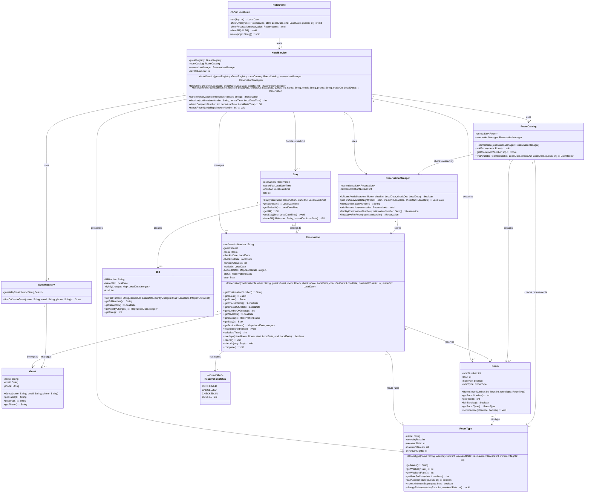
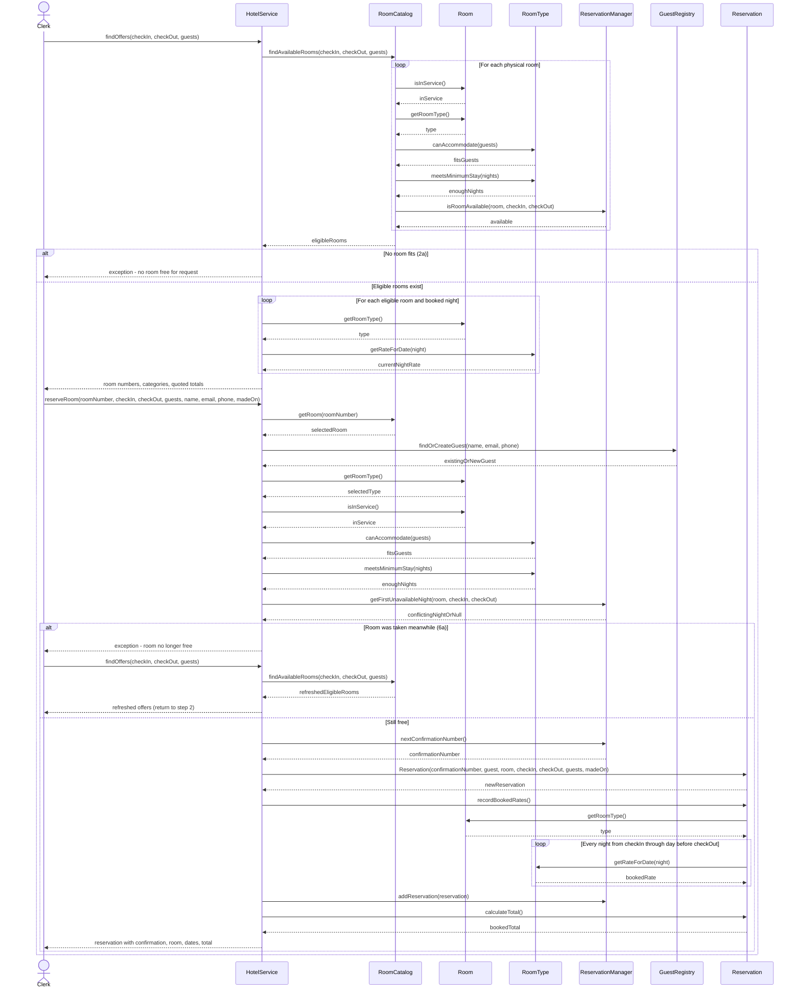
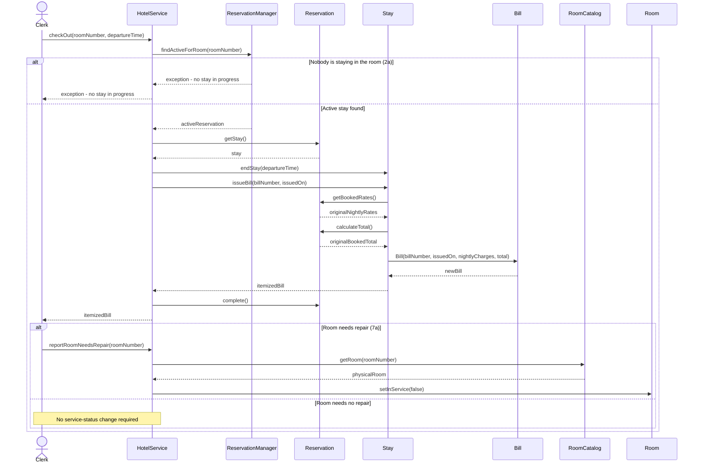

# Assignment 2: Kaashif Khan 

## Deliverable 1: Mapping Table
Entity      | Verdict   | Becomes      | If no class, where it went 
|---|---|---|---|
Guest       | One class | `Guest`        | - |
Room Type   | One class | `RoomType`     | - |
Room        | One class | `Room`         | - |
Reservation | One class | `Reservation`  | - |
Stay        | One class | `Stay`         | - |
Bill        | One class | `Bill`         | - |

**Explanation:** Each of the six entities becomes one class because each one represents a distinct part of the hotel system with its own information and responsibilities. I decided to keep RoomType as one class because standard, deluxe, and suite follow the same rules and only differ in their attribute values. That's why separate subclasses would add unnecessary complexity, none of the entities needed to be split or removed because each still serves a purpose in the software.

## Deliverable 2: Class Model

### Class Diagram 

### Responsibilities

- **Guest**: Responsible for: retaining one guest's identifying contact details. Traces to: entity Guest.
- **GuestRegistry**: Responsible for: looking up or registering hotel guests by email. Traces to: technical: UC-1 needs a searchable guest collection.
- **RoomType**: Responsible for: enforcing the terms of a room category. Traces to: entity Room Type.
- **Room**: Responsible for: representing the service condition of one physical room. Traces to: entity Room.
- **ReservationStatus**: Responsible for: representing a reservation's permitted lifecycle states. Traces to: technical: UC-2 through UC-4 require explicit status validation.
- **Reservation**: Responsible for: preserving the terms of an individual booking. Traces to: entity Reservation.
- **ReservationManager**: Responsible for: maintaining the collection of reservations. Traces to: technical: availability checks require all active bookings.
- **RoomCatalog**: Responsible for: selecting rooms eligible for a requested stay. Traces to: technical: UC-1 searches the whole room inventory.
- **Stay**: Responsible for: recording the actual visit through checkout. Traces to: entity Stay.
- **Bill**: Responsible for: preserving an itemized checkout charge record. Traces to: entity Bill.
- **HotelService**: Responsible for: coordinating clerk-initiated hotel use cases. Traces to: technical: several use cases cross multiple domain objects.
- **HotelDemo**: Responsible for: running the assignment's twelve-step scenario. Traces to: technical: deliverable 6 requires an executable demonstration.

I used no hierarchy and no interface because Standard, Deluxe, and Suite differ only in capacity, rates, and minimum nights, which are stored in RoomType instances rather than subclasses.

## Deliverable 3: Sequence Diagrams

### UC-1: Reserve a Room

### UC-4: Check Out

## Deliverable 4: Responsibility Table

Job | Owner | Method | Data it needs, and the class that holds it | 
|---|---|---|---|
| 1. Find a guest by email, or record a new guest | GuestRegistry | findOrCreateGuest(name: String, email: String, phone: String): Guest | Email indexed collection: GuestRegistry; guest contact values: Guest / method inputs. |
| 2. Say whether a room is free for every night of a date range | ReservationManager | isRoomAvailable(room: Room, checkIn: LocalDate, checkOut: LocalDate): boolean | Existing reservations and their status/date/room: ReservationManager → Reservation; requested room and dates: parameters / Room. |
| 3. Find every room that is in service, holds the guests, meets the minimum nights, and is free | RoomCatalog | `findAvailableRooms(checkIn: LocalDate, checkOut: LocalDate, guests: int): List<Room>` | Physical room list: RoomCatalog; service status: Room; capacity/minimum: RoomType; conflicts: ReservationManager. |
| 4. Say what one night costs for a room type at today's rates | RoomType | getRateForDate(date: LocalDate): int | Current weekday/weekend rates: RoomType; calendar day: LocalDate parameter. |
| 5. Say whether a stay is long enough for a room type | RoomType | meetsMinimumStay(nights: int): boolean | Minimum nights: RoomType; requested number of nights: parameter.  |
| 6. Record the rate booked for each night of a new reservation | Reservation | recordBookedRates(): void | Dates and frozen rate map: Reservation; room: Room; type's current rates: RoomType. |
| 7. Find a reservation by confirmation number | ReservationManager | findByConfirmationNumber(confirmationNumber: String): Reservation | Stored reservation list: ReservationManager; confirmation number: Reservation. | 
| 8. Work out what a guest owes at checkout | Reservation | calculateTotal(): int | Per-night rates frozen at booking: Reservation; checkout coordination: HotelService → Stay. | 

## Deliverable 7: Reflection

At first I considered putting the complete room search in ReservationManager since it already needed booking history to detect conflicts. However, while mapping UC-1 I noticed that it would make the reservation collection also own all physical rooms and the rules for filtering them. I ended up moving job 3, findAvailableRooms() to RoomCatalog. That class now iterates the inventory, asks RoomType about capacity and minimum nights, and gives booking conflicts to ReservationManager.isRoomAvailable(). As a result the two collections are kept separate while each class performs the calculation for which it has the information. 

I'm less certain about letting Stay.issueBill() construct the Bill instead of having HotelService create it directly. Putting bill creation on Stay makes the link between a completed visit and its one final bill explicit but it requires Stay to reach back to Reservation for booked charges. Creating bills in HotelService would simplify Stay, but would concentrate more business details in the workflow coordinator. If Harborview later supports seperate invoices or partially paid stays that change would test whether the current Stay owned bill creation still makes sense. 