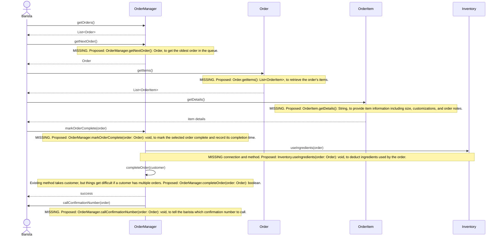

# Individual Sketch ��� Week [7] Round [1]
**Student:** [Kaashif Khan]
**Date:** [10/8/2026]

---

## 1. Tonight's Prompt

You'll draw one of tonight's use cases as a sequence diagram, using your group's class diagram exactly as it stands in `docs/design/class-model.md`. Don't fix the class diagram tonight. When it can't do what the use case needs, write a note and propose a fix. Your group uses those notes in the group build.

**Which use case is yours.** Sort your group by first name, A to Z. The first person takes UC-1, the second UC-2, the third UC-3, the fourth UC-4. In a group of three, nobody takes UC-4 now; your group does it together at the start of the group build.

**About the example.** It uses the library system from the textbook, not Brew & Byte. It shows you the *shape* of what to write and nothing else.

Copy step 1 into **section 1 of your sketch file** and put your diagram directly under it.

**Step 1: The sequence diagram.** One Mermaid `sequenceDiagram` for the **main flow** of your use case. Leave the alternative flows out. Every arrow follows these rules:

1. The actor is an `actor`. Every class is a `participant`, named exactly as it is in your class diagram.
2. The actor's first arrow goes to the class in your model that should receive the request.
3. Every solid arrow (`->>`) is a method call, labeled `methodName(arguments)`. **The method must already exist on the class the arrow points to**, in your class diagram.
4. **A class can only call a class it's connected to by a line in your class diagram.**
5. Every method that returns something gets a dashed return arrow (`-->>`) labeled with what comes back.
6. When rule 3 or rule 4 fails, draw the arrow you need anyway and put a `MISSING` note directly under it: the method you propose, with its full signature, and why that class.

**UC-2: Complete an Order**

## 2. What I'm Not Sure About

The part I am least sure about is how the OrderManager should handle completing a specific order. Our current class model has a `completeOrder(customer: Customer)` method, but this could cause problems if a customer has multiple active orders. I think it would make more sense to identify the order directly instead of identifying it through the customer.